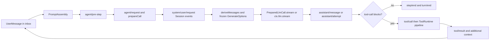

# Agent 执行数据流

[English](agent-execution-dataflow.md) | 中文

## Summary

本指南从队列输入到最终 Session 事件追踪一次 agent 轮次，使贡献者可以定位提示词、LLM 和工具执行之间每个交接的源码所有者。
核心规则是模型请求从 Session surface 重建，而不是被视为独立的可变 transcript。
提示词组装提供渲染后的系统文本、动态上下文和工具 schema；agent loop 会在流式传输已绑定的 LLM 调用前把这些值准入日志。
assistant 工具调用块会进入工具调度器，其按模型顺序写入的结果会成为同一轮次后续步骤的消息。

## Table of Contents

- [执行模型](#the-execution-model)
- [一次请求的端到端路径](#one-request-end-to-end)
- [输入和提示词准入](#input-and-prompt-admission)
- [绑定 LLM 请求](#binding-the-llm-request)
- [流式响应和工具反馈](#streaming-and-tool-feedback)
- [持久事实与实时协调](#durable-facts-and-live-coordination)
- [源码阅读地图](#source-reading-map)
- [进一步探索](#further-exploration)
- [Dev Note](#dev-note)

-----

## The execution model

一个轮次是外层的事务式工作单元，而一个步骤恰好是一项模型请求以及该 assistant 响应中的工具调用。
一个轮次可以包含多个步骤，因为工具结果和注入上下文会进入 `next-step` inbox，并使循环认领一个新的输入批次。
`packages/core/agent-loop/src/agent.ts` 中的 `ReactLoopAgent` 是驱动器；Cordis 服务和事件允许插件贡献行为，而无需修改该驱动器。

Session 日志不是在请求发出后才附加的审计记录。
`Session.deriveMessages()` 从 `system/message`、`user/message`、`assistant/message` 和 `tool/result` 事件折叠模型可见 surface，并应用追加和替换操作。
循环会在构造 `GenerateOptions` 请求时冻结这份派生历史，使到达模型的提示词和工具反馈能够从记录事实中重现。

该图表达所有权而非线程身份：`tools/execute` 的工具主体可与其他并行主体重叠，而准入和结果提交保持模型顺序。

-----

## One request end to end

以下顺序是排查提示词缺失、模型路由异常或工具结果未进入下一请求时最有用的主干。

1. `followup()`、`steer()` 或 `inject()` 将 `UserMessage` 放入 agent inbox；只有可唤醒输入会启动或唤醒驱动器。
2. 驱动器追加 `turn/start`、认领 `next-turn` 或 `next-step` 批次，并调用 `ctx.systemPrompt.assemble(assembleContextFor(agent, signal))`。
3. `agent/pre-step` waterfall 在动态运行时上下文由当前组装准备完成后，接受、重写或拒绝已认领消息。
4. 对于进入的步骤，驱动器追加 `step/start`、运行 `agent/request`，并调用 `ctx.llm.prepareCall()` 以捕获提供方路由及其路由相关能力。
5. 循环协调渲染后的系统提示词、追加首个 attempt 的用户消息、记录有效请求头和上下文，并派生不可变消息历史。
6. 已准备调用或 `ctx.llm.stream()` 产生 `StreamChunk` 值；循环在组装紧凑持久流的同时发布实时 assistant frame。
7. 完成的响应成为 `assistant/message`；未成功、取消或终端错误的 attempt 会成为 `assistant/attempt`，除非被中断的内容可以记录为消息。
8. 每个 assistant `tool-call` 块都经由 `ctx.tools` 调度；其最终模型可见结果会追加为 `tool/result`，随后任何额外上下文会排队给下一步骤。
9. 循环追加 `step/end`；它要么结束轮次，要么认领已排队的 next-step 批次并从提示词组装重新开始。

`AbortSignal` 在步骤中共享，但循环会在每个异步准入点检查取消。
当 `agent/request` 或 `prepareCall()` 正在等待时发生取消，不会提交该 attempt 的渲染系统提示词或已进入的用户消息。

-----

## Input and prompt admission

### Inbox 消息是提议，尚非模型上下文

inbox 区分 `next-turn` 和 `next-step` 输入。
`followup()` 提供可唤醒的 next-turn 输入，`steer()` 提供可唤醒的 next-step 输入，`inject()` 提供非唤醒的 next-step 输入；它会等待其他工作打开步骤边界。
认领会在 `agent/pre-step` 之前从 inbox 移除消息；监听器可以拒绝它们，或返回重写后的 `enter` 决策。

`systemPrompt.assemble()` 在 `agent/pre-step` 之前运行，因为后者收到的是已由当前组装准备好的动态运行时上下文。
组装包含有序提示词段落、有序动态上下文段落、可见工具 schema 和提示词变量。
只有当前 agent scope 的作用域注册参与组装，因此 agent preset 能改变自身可见提示词或工具，而不会修改其他 agent 的组装。

### 提示词文本成为 Session 消息

`renderPrompt(assembly)` 将已组装段落插值为一个系统提示词字符串。
`SystemPromptProjection` 将该字符串转换为一个或多个 `system/message` surface 操作，而非将独立的 `system` 字段放入 `request/header`。
首个步骤即使渲染为空也会保留第一个 system node；空系统消息在派生历史时不会产生协议消息。

在支持 `systemPromptUpdate: 'in-history'` 的连续路由上，变更后的非空提示词可以追加到缓存历史之后。
否则，新请求序列、不具备该能力的路由或空渲染会替换第一个 system node，并清空之后活跃的 system node。
这说明提示词变更是可回放的模型输入，而不是进程内配置。

### 动态上下文有意使用 user role

`PromptContext` 贡献与提示词段落分开渲染。
`RuntimeContextProjection` 只在连接后的上下文发生变化时发出插件所有的 `user/message` 快照；当保留的快照消失时，它也会记录清除标记。
默认 `agent/pre-step` 决策将该快照加在已认领用户消息之后，因此它进入同一 Session surface，并遵循相同的压缩和回放规则。

-----

## Binding the LLM request

`agent/request` 接收提议的 `LlmCallConfig`，并可在适配器解析前替换它。
循环在该 waterfall 后要求 provider 和 model，然后 `prepareCall()` 捕获有效配置、重试策略、模型上下文元数据、系统提示词更新模式、适配器所有的默认值，以及将派发这次调用的适配器注册。
捕获的 `PreparedLlmCall` 防止之后的适配器注册表变更改变已经准入的请求。

循环在首次发起、恢复、变更或开始新序列时记录规范化的 `request/header`。
该 header 包含有效配置、非空工具 schema 和已实体化的适配器默认值；`request/context` 单独记录已解析路由元数据，例如上下文窗口和系统提示词更新能力。
这两个事件都不替代消息历史：`buildRequest()` 会在提示词和用户消息准入后调用 `session.deriveMessages()`，然后深度冻结结果中的 `messages`、`tools` 和调用配置。

因此，`GenerateOptions` 以三类来源跨越 LLM 边界。

| 请求字段 | 所有者 | 记录或冻结原因 |
| --- | --- | --- |
| `provider`、`model` 和调用选项 | `agent/request` 加 `PreparedLlmCall` | Session header 记录有效请求 envelope。 |
| `messages` | 当前 Session surface | 回放重建精确模型历史，而不是保留可变请求 transcript。 |
| `tools` | `PromptAssembly.tools` | header 保存模型能够调用的 schema 集合。 |
| `signal` | 运行中的步骤 | 它控制进行中的工作，但不是持久模型上下文。 |

无论循环调用 `preparedCall.stream(request)` 还是常规 `ctx.llm.stream(request)` 路径，流都会经过 `llm/stream` waterfall。
中间件可以包装流，而 LLM runtime 和 invariant installer 会在提供方输出周围强制执行流协议。

-----

## Streaming and tool feedback

### 一个流具有实时投影和持久结算

`AssistantStreamAttempt` 消费 `StreamChunk` 值，并为本地增量 UI 或 SDK 消费方发出 `agent/assistant-stream` frame。
这些 chunk frame 是瞬态数据；只有在 attempt 结算为 `assistant/message` 或 `assistant/attempt` 时，完整紧凑流才会被嵌入。
成功内容会创建 assistant 消息，其中包含 provider、model、可选 replay state、usage 和流。
错误或 abort finish 可以进入 `agent/request-error`，其 retry 动作会重复同一渲染组装的请求准备和协调，而不重复 pre-step 准入或首个用户消息追加。

只有成功的 assistant 消息会成为候选模型历史。
循环在结算后从其 `tool-call` 内容块中提取工具调用，因此工具执行总是跟随已经记录的 assistant 决策，而非部分实时分片。

### 工具执行在日志边界保留模型顺序

`executeToolCalls()` 解析每个块的参数、分类调度模式，并在调用进入注册表调度器前立即追加 `tool/call`。
排他调用形成屏障；声明为并行的调用可最多重叠 `maxParallelToolCalls` 个，但后续调用会在启动前重新分类。
调度器按 assistant 顺序而非完成顺序排出已完成工作，因此每个 `tool/result` 都会按相应模型顺序写入。

工具注册表依次应用 `tools/pre-execute`、单调 guard、`tools/execute`、定义主体、`tools/post-execute`、定义所有的内容定稿，以及只读的 `tools/result` 通知。
策略可以在派发前拒绝或请求审批，包装层可以在派发周围增加超时或测量行为，后置监听器可以替换、阻止或给规范化结果附加额外上下文。
最终结果会在观察者收到它之前被实体化为无损 JSON 并冻结。

`appendToolResult()` 将最终结果的渲染内容和错误位转换为 tool role 消息、把事件关联到其 `tool/call` 序列号，并将其追加到 Session surface。
所有 `additionalContexts` 会在已记录工具结果之后插入 next-step inbox；它们不会越过解释其存在原因的工具反馈。

### 什么会引发下一次请求

没有工具调用时，步骤以 `completed` 结束。
标记为 `concludesTurn` 的工具结果会让当前步骤完成；只有不存在 next-step 输入（包括工具返回的上下文）时，循环才会关闭该轮次。
中止的调度器会为尚未启动的调用记录合成错误结果，在轮次报告其 aborted 结束前保留可回放的工具调用/结果序列。

-----

## Durable facts and live coordination

下列区分可以避免常见集成错误：实时事件能协调当前进程，但只有 Session 事件能在重新加载或 fork 后重建模型所见内容。

| 关注点 | 持久 Session 事件或投影 | 实时协调事件 |
| --- | --- | --- |
| 轮次和步骤边界 | `turn/*` 和 `step/*` | `agent/status` 报告驱动器状态。 |
| 提示词和用户输入 | `system/message` 和 `user/message` surface node | `agent/pre-step` 决定当前已认领批次。 |
| 路由和工具 schema 集合 | `request/header` 和 `request/context` | `agent/request` 提议当前调用配置。 |
| Assistant 进度 | 已结算的 `assistant/message` 或 `assistant/attempt` 嵌入紧凑流 | `agent/assistant-stream` 承载 start、chunk 和 end frame。 |
| 工具工作 | `tool/call` 和 `tool/result` 提供可回放调用/结果对 | `tools/pre-execute`、`tools/execute`、`tools/post-execute` 和 `tools/result` 控制或观察工作。 |

对于 transcript、已恢复 agent 或新的模型请求，请读取 Session 日志及其派生 surface。
对于本进程中的请求拦截、取消、队列观察或增量渲染，请订阅相应的 `agent/*`、`llm/stream` 或 `tools/*` 事件。

-----

## Source-reading map

当执行路径需要源码级确认时，请按以下文件顺序阅读。

| 问题 | 主要所有者 | 补充参考 |
| --- | --- | --- |
| 轮次如何认领输入并重复步骤？ | [`agent.ts`](../packages/core/agent-loop/src/agent.ts) | [Agent 生命周期](agent-lifecycle.zh.md) |
| 段落、上下文、变量和 schema 如何组装？ | [`system-prompt/src/index.ts`](../packages/core/system-prompt/src/index.ts) | [系统提示词](subsystems/system-prompt.zh.md) |
| 提示词或运行时上下文如何成为历史？ | [`runtime-context.ts`](../packages/core/agent-loop/src/runtime-context.ts) | [Session 参考](subsystems/session.zh.md) |
| 提供方派发前冻结了什么？ | [`agent.ts`](../packages/core/agent-loop/src/agent.ts) 和 [`session/src/index.ts`](../packages/core/session/src/index.ts) | [LLM 流](subsystems/llm-streaming.zh.md) |
| 流分片如何结算？ | [`assistant-stream.ts`](../packages/core/agent-loop/src/assistant-stream.ts) | [Agent 生命周期](agent-lifecycle.zh.md) |
| 工具调用如何调度和提交？ | [`tool-calls.ts`](../packages/core/agent-loop/src/tool-calls.ts) | [工具执行流水线](tool-execution-pipeline.zh.md) |
| 哪些策略阶段可以改变工具结果？ | [`tools/src/index.ts`](../packages/core/tools/src/index.ts) | [工具](subsystems/tools.zh.md) |

## Further Exploration

- [架构轮次流](architecture.zh.md#turn-flow) 给出紧凑的仓库级生命周期。
- [Agent 生命周期](agent-lifecycle.zh.md) 按顺序展示持久和实时事件。
- [工具执行流水线](tool-execution-pipeline.zh.md) 详述审批、guard 和结果定稿。
- [系统提示词](subsystems/system-prompt.zh.md) 定义提示词组装类型和注册。
- [LLM 流](subsystems/llm-streaming.zh.md) 定义请求、消息、适配器和流词汇。

## Dev Note

None.
